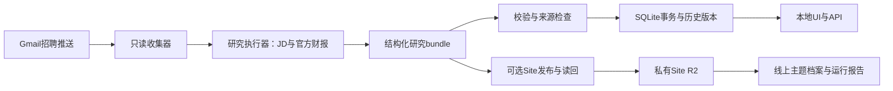

# 系统架构

来源：ASSISTANT A-002/A-004/A-010，服务USER U-001至U-015。

研究执行器是明确的扩展边界：目前不随仓库提供自动模型实现。已验证的生产研究是会话/ChatGPT路径，不是SQLite runner已自动搜完六家公司。

`worker/index.js` 是共享读取/写入API；Sites直接使用R2 binding；本地Node服务器传入SQLite实现的同一BUCKET契约。SQLite是独立运行存储，不是声称线上Site已经换成SQL。

同步到Site非跨对象事务：岗位先写、报告最后写并验证。部分网络失败可能已写入一些岗位；重试同稳定主键收敛，不能称为全站原子发布。SQLite导入bundle在单事务中完成，失败回滚。
